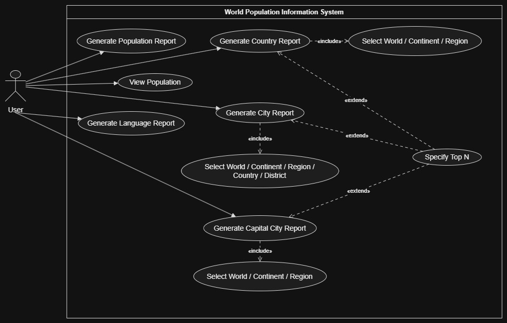

# World Population Information System - Use Case Explanation

This document provides an explanation of the use cases depicted in the World Population Information System diagram.

## 1. System Boundary and Actor

* **System:** World Population Information System
* **Actor:** **User** - The individual interacting with the application to retrieve various demographic and population reports.

## 2. Primary Use Cases

The User can directly initiate the following core actions within the system:

* **View Population:** The user can view general population statistics.
* **Generate Population Report:** The user can generate a high-level report regarding general population metrics.
* **Generate Language Report:** The user can generate reports detailing the distribution and usage of specific languages globally.
* **Generate Country Report:** The user can generate a report detailing country-specific population data.
* **Generate City Report:** The user can generate a report detailing city-specific population data.
* **Generate Capital City Report:** The user can generate a report specifically for capital cities.

## 3. Included Relationships (`<<include>>`)

Included relationships represent mandatory steps that must occur to complete the base use case.

* **Select World / Continent / Region:**
    * Included in **Generate Country Report** and **Generate Capital City Report**.
    * *Explanation:* Whenever a user generates a country or capital city report, they *must* specify the geographical scope (e.g., the whole world, a specific continent, or a specific region).

* **Select World / Continent / Region / Country / District:**
    * Included in **Generate City Report**.
    * *Explanation:* When generating a city report, the user *must* define the scope, which offers more granular options including specific countries or districts.

## 4. Extended Relationships (`<<extend>>`)

Extended relationships represent optional behavior that can be added to the base use case under specific conditions.

* **Specify Top N:**
    * Extends **Generate Country Report**, **Generate City Report**, and **Generate Capital City Report**.
    * *Explanation:* When running any of these three primary reports, the user has the *option* to limit the results to a specific number of top entries (e.g., "Top 10 most populated countries in Europe").