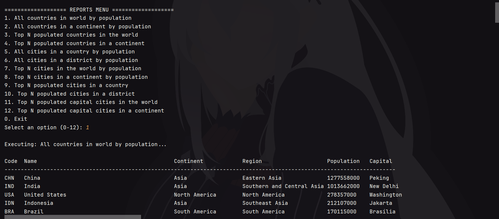
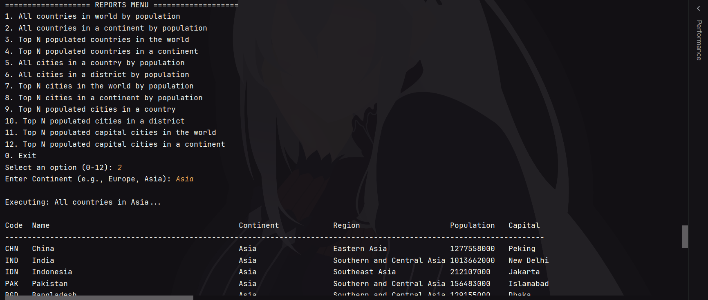
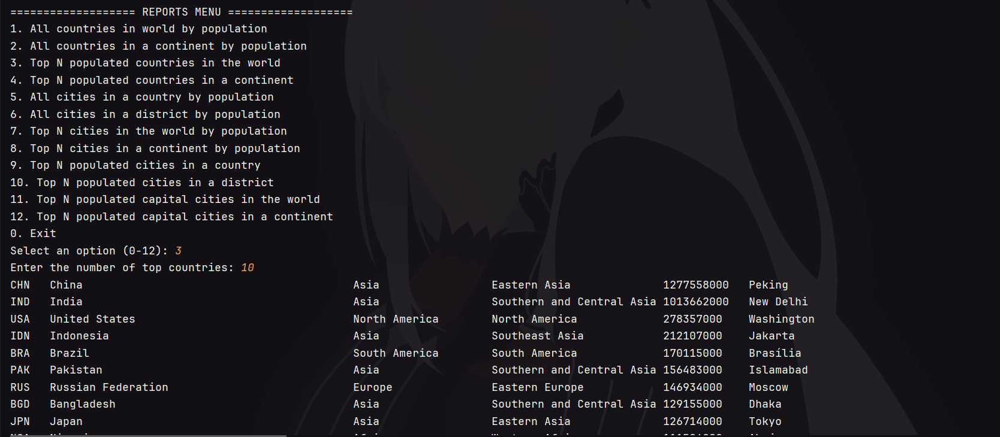
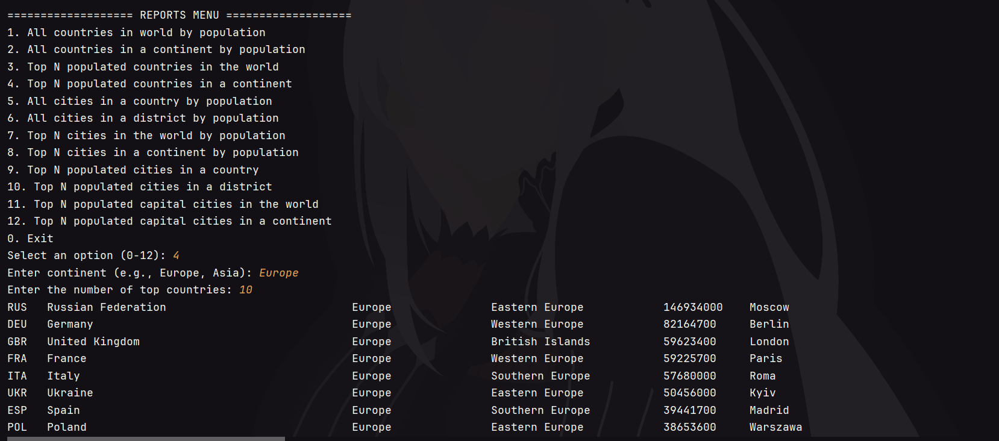
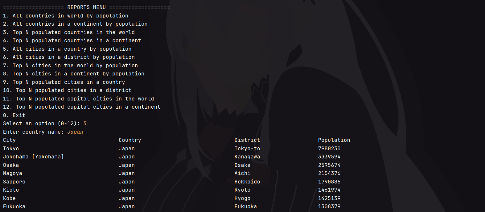
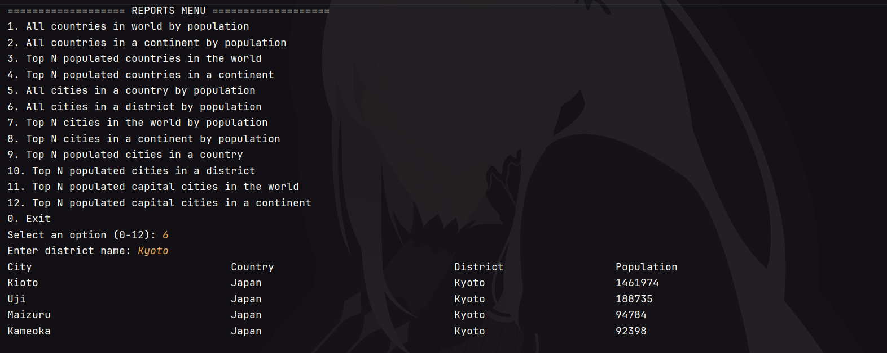
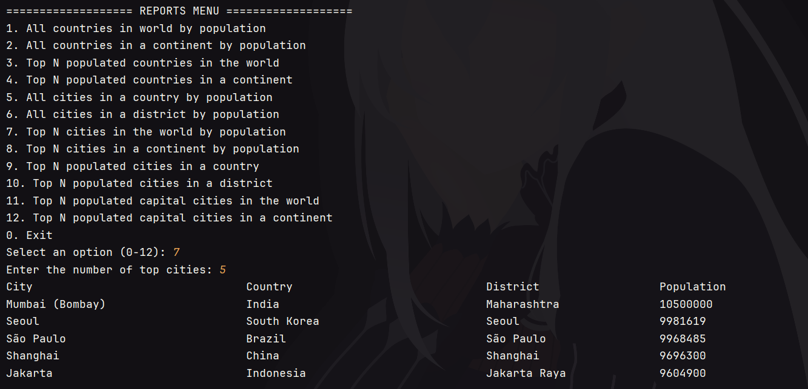
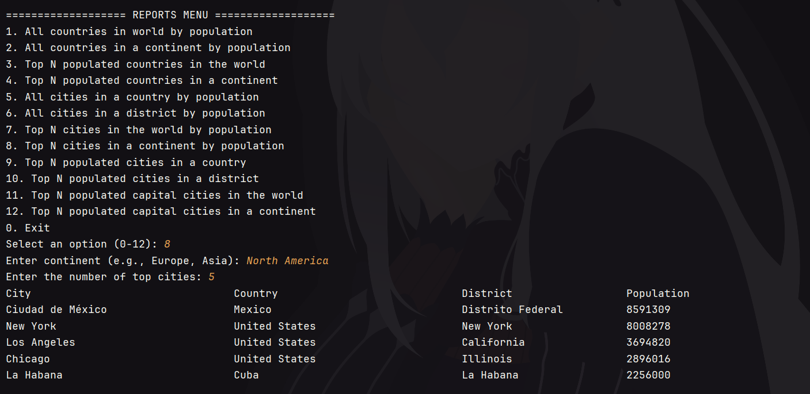
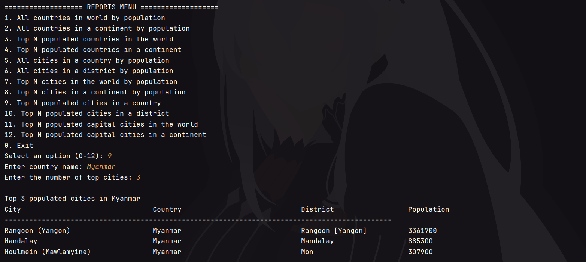
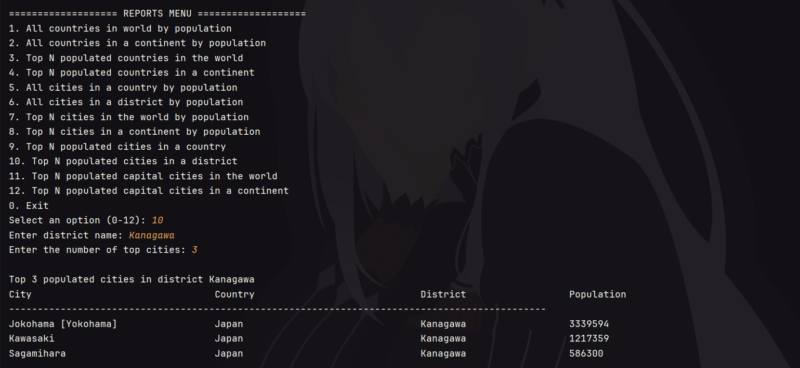

# GP20 World Database App

**SET09803 DevOps Coursework: Population Information System**

---

## 1. Project Overview

This project is a population reporting application developed in Java as part of a Scrum team for the SET09803 DevOps module. The application connects to a MySQL database to execute queries and generate structured population reports covering global countries, continental populations, district/country cities, and capital cities.

---

## 2. Getting Started / Build Instructions

### Prerequisites
- **Java Development Kit (JDK):** Version 17 or higher
- **Apache Maven:** Version 3.8 or higher
- **Docker & Docker Compose:** For application deployment with containers and MySQL database hosting

### Build & Execution Commands
- **Build application executable with Maven:** `mvn clean package`
- **Run standalone JAR file:** `java -jar target/app-1.0-SNAPSHOT-jar-with-dependencies.jar`
- **Build Docker Image:** `docker build -t gp20-app .`
- **Launch database and application stack with Docker Compose:** `docker-compose up --build`

---

## 3. Project Management & Planning

- **Kanban Board:** We used a GitHub Projects Kanban board to track user story progress through the backlog, perform status checks, and conduct code reviews.
- **Backlog & Issues:** System requirements are mapped directly to GitHub Issues tagged with specific labels, estimations, and assignee allocations across different Sprints.

---

## 4. System Architecture & Use Cases

- **Requirements Gathering:** Initial customer requirements were gathered and formalized into structured user stories with explicit acceptance criteria.
- **Use Case Documentation:** Complete use case specifications, descriptions, and use case diagrams are available in the repository branch [`feature/documents-fix-write`].

---

## 5. Branching Strategy & CI/CD Pipeline

- **GitFlow Workflow:**
    - `master`: Production-ready release code.
    - `develop`: Active integration branch for feature merges.
    - `feature/*`: Dedicated topic branches for individual work and issues (e.g., `feature/country-reports`).
- **CI/CD via GitHub Actions:** Automated GitHub Workflows trigger on pushes and pull requests to validate code compilation, run automated integration tests, assemble self-contained JAR artifacts, and publish Docker containers.

---

## 6. Requirements Met Summary

**10 out of 32 requirements have been implemented for this release phase of the first sprint, which is 31.25%.**

| ID | Issue # | Name of Requirement | Met | Screenshot / Evidence |
| :---: | :---: | :--- | :---: | :--- |
| I01 | #3 | All the countries in the world organised by population. | Yes |  |
| I02 | #4 | All the countries in a continent organised by population. | Yes |  |
| I03 | #9 | Top `N` populated countries in the world. | Yes |  |
| I04 | #10 | Top `N` populated countries in a continent. | Yes |  |
| I05 | #15 | All the cities in a country by population. | Yes |  |
| I06 | #16 | All the cities in a district by population. | Yes |  |
| I07 | #20 | Top `N` populated cities in a country. | Yes |  |
| I08 | #21 | Top `N` populated cities in a district. | Yes |  |
| I09 | #25 | Top `N` populated capital cities in the world. | Yes |  |
| I10 | #26 | Top `N` populated capital cities in a continent. | Yes |  |